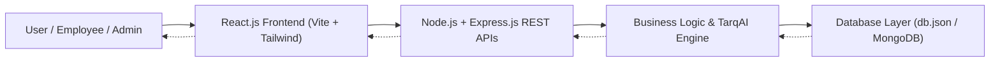

# Enterprise Service Request Backend Management System (Enterprise-ServiceHub)

> **Tarqdev Solutions** &bull; MERN Stack Developer Internship Project  
> **Technical Guide:** Mohan B &bull; **Contact:** tarqinfo@tarqdev.com | +91 70324 59407

[](https://nodejs.org/)
[](https://expressjs.com/)
[](https://react.dev/)
[](https://www.mongodb.com/)
[](https://tailwindcss.com/)

---

## 1. Project Overview

The **Enterprise Service Request Backend Management System** is a centralized, production-ready enterprise web application designed to manage the end-to-end lifecycle of technical, operational, and organizational service requests.

Developed under the guidance of **Mohan B** during the MERN Stack Internship at **Tarqdev Solutions**, the system replaces disconnected spreadsheets and email threads with a unified operational platform featuring:
- **Intelligent Service Request Lifecycle:** Request creation, multi-level department assignment, workflow stage transitions (`Open` &rarr; `In Progress` &rarr; `On Hold` &rarr; `Resolved` &rarr; `Closed`), SLA tracking, and resolution logging.
- **Master Queue:** Real-time search, multi-field filtering (Status, Priority, Category), column sorting, and pagination.
- **Comments & Audit Trail:** Real-time collaborative discussions with `Internal Staff Note` toggle, accompanied by immutable activity audit logging (`STATUS_CHANGE`, `ASSIGNED`, `TICKET_CREATED`, `AI_CLASSIFIED`).
- **Live Staff Workload Registry:** Real-time calculation of active tickets per staff member with `Low`, `Medium`, and `High` workload indicators to prevent burnout and ensure rapid SLA resolution.
- **TarqAI Heuristic & Generative Engine:** Automatic classification of categories and priorities with instant AI executive summaries.
- **Analytics & Reporting Dashboard:** Visualizations for Category Distributions, Created vs. Resolved monthly trends, and CSV export capabilities.

---

## 2. System Architecture



### Layer Breakdown
1. **Frontend Layer (React 18 + Tailwind CSS + Lucide Icons):** Glassmorphic dark enterprise dashboard matching modern cloud suites with instant state sync, modals, charts, and toast notifications.
2. **Backend/API Layer (Node.js + Express.js):** RESTful endpoints handling request lifecycle, authentication, role-based access control, search, pagination, and AI suggestions.
3. **Database Layer (Mongoose/MongoDB Schema):** Persistent data store maintaining requests, users, departments, activity audit logs, and embedded comments.

---

## 3. Directory Layout

```
Enterprise-ServiceHub/
├── backend/
│   ├── config/
│   │   └── database.js          # DB file and connection manager
│   ├── controllers/
│   │   ├── requestController.js   # CRUD, filtering, pagination, workflow
│   │   ├── analyticsController.js # Operational metrics & aggregations
│   │   ├── userController.js      # Auth, staff workload directory
│   │   └── aiController.js        # TarqAI auto-classifier & summarizer
│   ├── middleware/
│   │   └── authMiddleware.js      # JWT verification & role authorization
│   ├── data/
│   │   └── db.json                # Seeded persistent storage
│   ├── utils/
│   │   ├── dbAdapter.js           # Full MongoDB-style query engine
│   │   └── seedData.js            # Enterprise realistic seed data
│   ├── server.js                  # Express application root
│   └── package.json
├── frontend/
│   ├── src/
│   │   ├── components/
│   │   │   ├── Navbar.jsx               # Branded topbar with global search
│   │   │   ├── Sidebar.jsx              # Navigation pane & platform status
│   │   │   ├── StatCard.jsx             # KPI indicator cards with sparklines
│   │   │   ├── CategoryDonutChart.jsx   # Donut chart for category distribution
│   │   │   ├── ResolutionTrendChart.jsx # Monthly Created vs. Resolved bars
│   │   │   ├── WorkloadProgress.jsx     # Staff capacity progress bars
│   │   │   ├── CreateRequestModal.jsx   # Submission modal with AI classify
│   │   │   ├── RequestDetailsModal.jsx  # Workflow stepper, comments & audit log
│   │   │   ├── AssignRequestModal.jsx   # Staff selection with live workloads
│   │   │   └── Toast.jsx                # Floating enterprise alert banners
│   │   ├── pages/
│   │   │   ├── LoginPage.jsx            # Dynamic role-selector sign-in page
│   │   │   ├── DashboardPage.jsx        # Operations overview & recent stream
│   │   │   ├── MasterQueuePage.jsx      # Paginated master tickets queue
│   │   │   ├── AnalyticsPage.jsx        # Performance metrics & CSV export
│   │   │   └── SettingsPage.jsx         # Engine parameters & internship info
│   │   ├── context/
│   │   │   └── AuthContext.jsx          # User state & role switcher
│   │   ├── services/
│   │   │   └── api.js                  # Centralized REST API client
│   │   ├── App.jsx
│   │   └── main.jsx
│   ├── vite.config.js
│   ├── tailwind.config.js
│   └── package.json
├── start.bat                     # Quick one-click execution script
├── README.md
└── package.json
```

---

## 4. Key Features & Screenshot Alignment

| Screenshot / Screen | Implementation Details |
|---|---|
| **Screenshot 1: Login Page** | Branded Tarqdev Solutions glassmorphism layout, role selector pills (`ADMIN`, `MANAGER`, `EMPLOYEE`), quick 1-click credentials, and secure JWT auth. |
| **Screenshot 2: Dashboard** | 4 Top KPI cards (`3,481 Total`, `189 Pending`, `3,292 Resolved`, `4.2 hrs Avg`), Category Donut chart, and Recent Requests table with live search and status badges. |
| **Screenshot 3: Create Request** | Modal with Step indicator, Title, Category, Department, Description, and **"✨ AI Auto-Classify & Suggest"** button generating instant category/priority and summary. |
| **Screenshot 4: Master Queue** | Full multi-field filtering (`Status`, `Priority`, `Category`), regex search, column sorting, pagination controls, and row action triggers (`View Details`, `Assign`). |
| **Screenshot 5: Request Details** | Interactive workflow stepper (`[Open]` `[In Progress]` `[On Hold]` `[Resolved]` `[Closed]`), Assigned Staff card, glowing purple AI Summary box, SLA badges, and multi-tab viewer. |
| **Screenshot 6: Request Assignment** | Modal displaying candidate staff members (`Sarah Jenkins`, `David Chen`, `Emily Taylor`) with live active workload badges (`Low`, `Medium`, `High`). |
| **Screenshot 7: Comments & Audit Trail** | Tabbed interface showing threaded discussions with `Internal Staff Note` badge, and an immutable vertical activity audit timeline. |
| **Screenshot 8: Analytics Dashboard** | Date range filter, CSV report download, 4 operational KPI metrics, Resolution Trend bar chart (May - Sep 2026), and staff capacity bars. |

---

## 5. REST API Specifications

### Service Requests
- `GET /api/requests` - Query with `?page=1&limit=10&search=&status=&priority=&category=&sortBy=createdAt&order=desc`
- `GET /api/requests/:requestId` - Retrieve single request details with comments and history
- `POST /api/requests` - Submit a new service request
- `PUT /api/requests/:requestId/assign` - Assign to staff member with department tracking
- `PUT /api/requests/:requestId/status` - Transition request status and append to audit trail
- `POST /api/requests/:requestId/comments` - Append comment with optional `isInternal` flag

### Analytics & AI
- `GET /api/analytics/overview` - Operational overview, category distribution, workload, and trends
- `POST /api/ai/classify` - NLP auto-detection of category, priority, and executive summary
- `GET /api/export/csv` - Download complete service request archive in CSV format

### Authentication & Users
- `POST /api/auth/login` - Sign in and receive JWT token
- `GET /api/auth/me` - Profile of currently logged in user
- `GET /api/staff` - Staff directory with live workload metrics

---

## 6. Authorized Role Credentials

You can sign in using any of the 1-click role buttons on the login screen or with these credentials:

| Role | Access Level | Email | Password |
|---|---|---|---|
| **Admin** | Full System & Configuration | `admin@tarqdev.com` | `password123` |
| **Manager** | Queue Management & Staff Assignment | `manager@tarqdev.com` | `password123` |
| **Employee** | Service Desk Execution & Technical Notes | `employee@tarqdev.com` | `password123` |

---

## 7. How to Run the Application

### Option A: Turnkey Execution (Single Command / Script)
Simply double-click `start.bat` or run:
```powershell
cd C:\Users\Home\.gemini\antigravity\scratch\enterprise-service-hub
.\start.bat
```
Then open your browser at **http://localhost:5000**.

### Option B: Node.js CLI
```powershell
# 1. Start the Full-Stack Server
cd C:\Users\Home\.gemini\antigravity\scratch\enterprise-service-hub\backend
node server.js
```
The server will be available at **http://localhost:5000** serving both the REST APIs and the React web portal.

### Option C: Frontend Hot-Reload Development Mode
```powershell
# In terminal 1 (Backend API):
cd C:\Users\Home\.gemini\antigravity\scratch\enterprise-service-hub\backend
node server.js

# In terminal 2 (Vite Dev Server with HMR):
cd C:\Users\Home\.gemini\antigravity\scratch\enterprise-service-hub\frontend
npm run dev
```
Open **http://localhost:3000** with instant hot-module replacement connected to the backend on port 5000.

